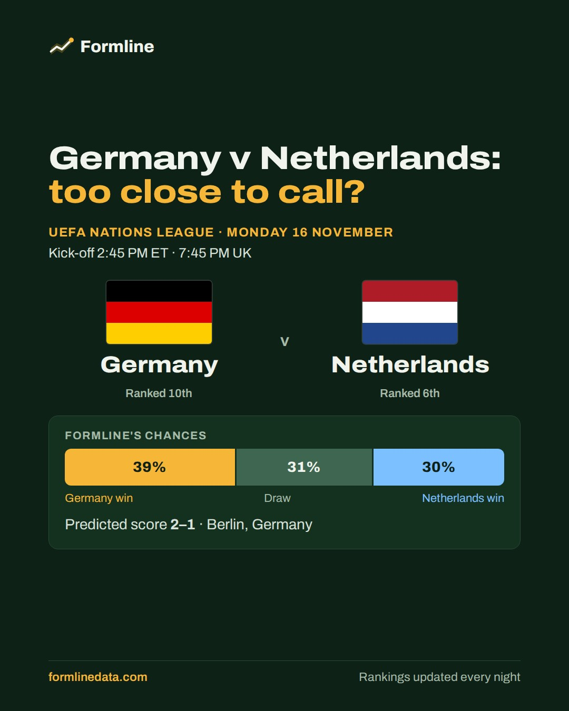
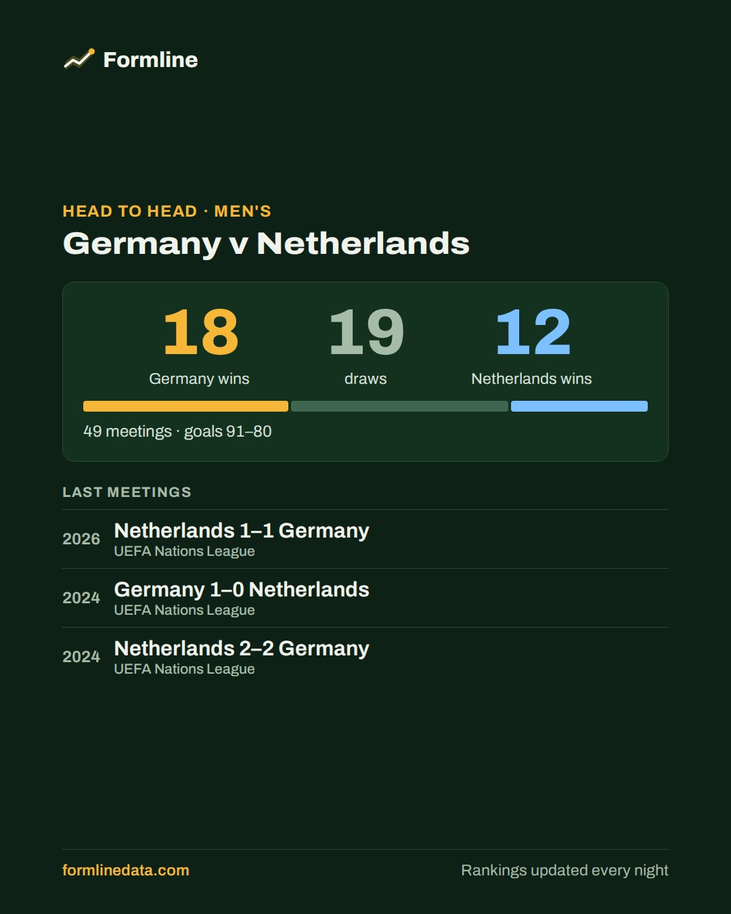
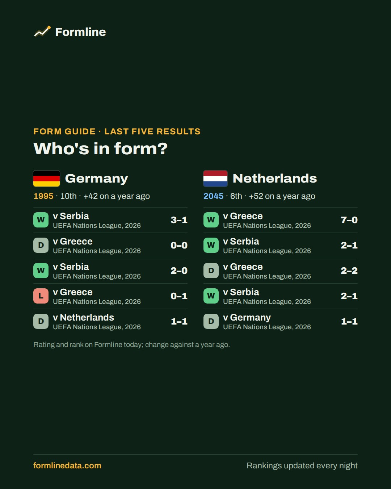
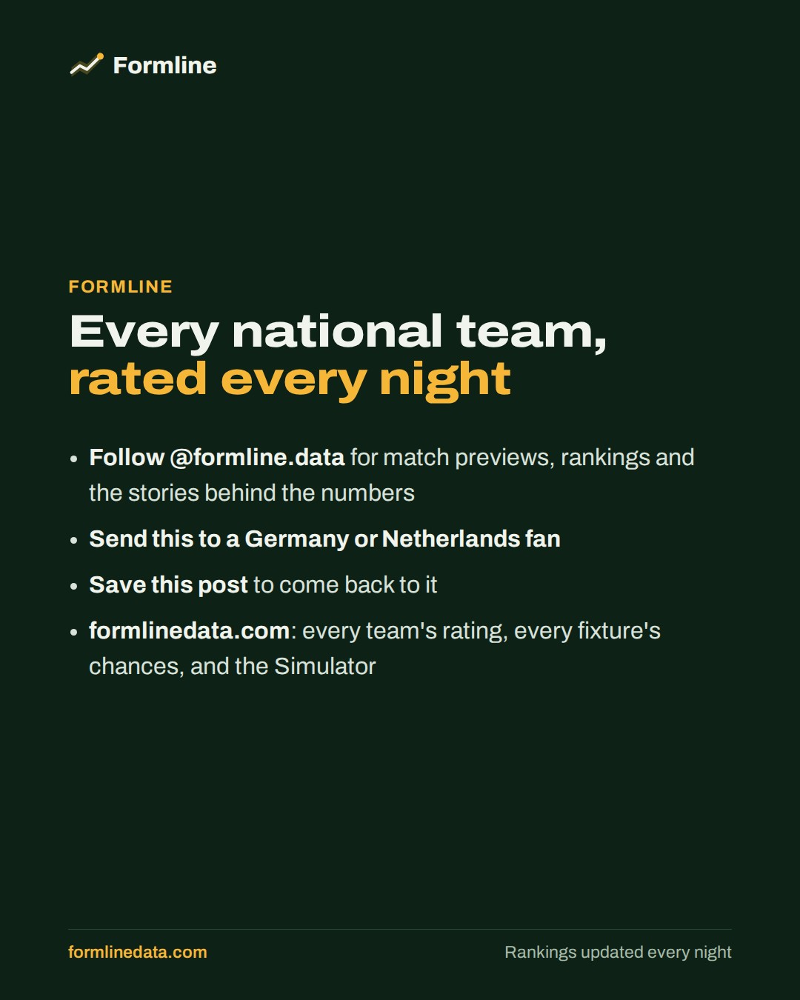
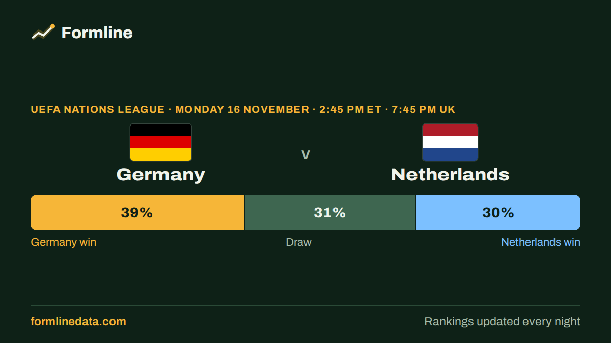

**This evening's post goes out on Bluesky and Instagram at about 6 pm Toronto time (7 pm in summer)** (on each one that's connected). To stop it, close this issue. To change it, ask Claude.

   

<sub>The last slide goes to Instagram only.</sub>

<details><summary>Alt text for each image (added automatically on Bluesky and Instagram)</summary>

1. UEFA Nations League, Monday 16 November: Germany (ranked 10th) v Netherlands (ranked 6th), in Berlin, Germany, kick-off 2:45 PM ET, 7:45 PM UK. Formline's chances: Germany win 39%, draw 31%, Netherlands win 30%. Predicted score 2–1.

2. Head to head, Germany v Netherlands (men's): 49 meetings, Germany 18 wins, 19 draws, Netherlands 12 wins, goals 91–80. Last meetings: 2026, Netherlands 1–1 Germany (UEFA Nations League); 2024, Germany 1–0 Netherlands (UEFA Nations League); 2024, Netherlands 2–2 Germany (UEFA Nations League).

3. Form guide, last five results. Germany (rating 1995, 10th): won 3–1 v Serbia; drew 0–0 v Greece; won 2–0 v Serbia; lost 0–1 v Greece; drew 1–1 v Netherlands. Netherlands (rating 2045, 6th): won 7–0 v Greece; won 2–1 v Serbia; drew 2–2 v Greece; won 2–1 v Serbia; drew 1–1 v Germany.

4. Formline: every national team, rated every night. Follow @formline.data for match previews and rankings, and visit formlinedata.com.
</details>

**Instagram caption**
```text
Germany v Netherlands prediction: UEFA Nations League, Monday 16 November 🇩🇪 🇳🇱 🗓️
⏰ Kick-off 2:45 PM ET · 7:45 PM UK

📊 Germany are favourites. Formline's chances: Germany 39%, draw 31%, Netherlands 30%. Predicted score 2–1.

🤝 All-time: Germany 18 wins, 19 draws, Netherlands 12 wins (49 meetings).

🔥 Last five: Germany WDWLD, Netherlands WWDWD.

Who are you backing? 👇 Every upcoming match has a preview on Formline (link in bio).

#DieMannschaft #Oranje #NationsLeague #MatchPreview
```

---

**X version**, to post by hand: long-press the image to save it, then copy the text below.



```text
🇩🇪 Germany v Netherlands 🇳🇱 · Monday 16 November

📊 Germany 39% · Draw 31% · Netherlands 30%
🎯 Predicted score: 2–1
🤝 Head to head: 18–19–12

https://formlinedata.com/matches/men/2026-11-16-germany-vs-netherlands.html
```

<sub>match · match|men|2026-11-16|Germany|Netherlands · @formlinedata</sub>
