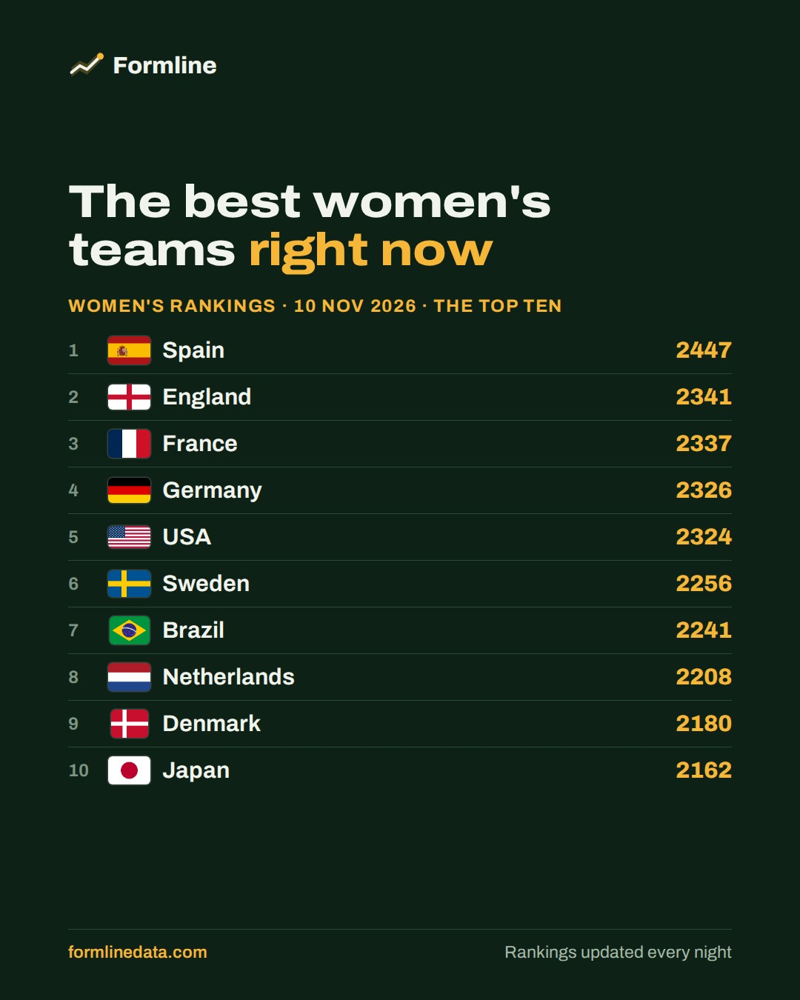
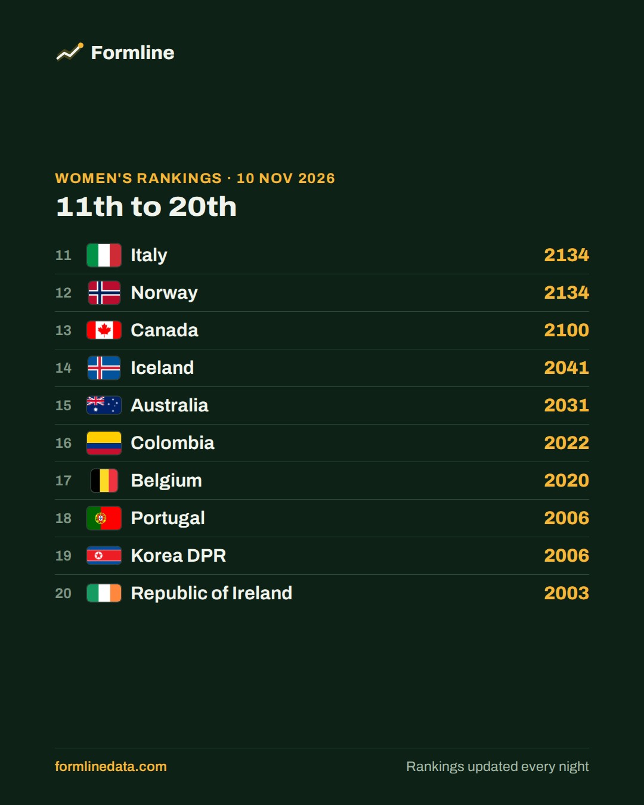
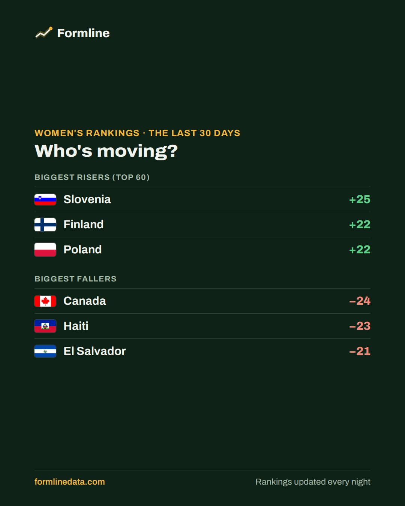
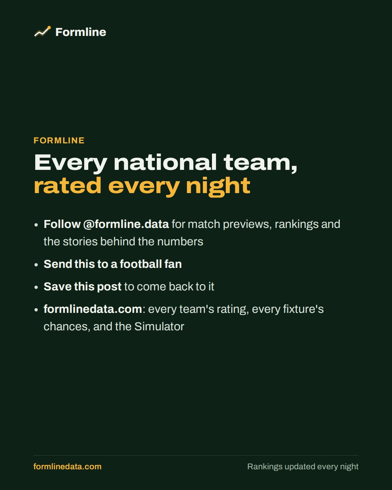
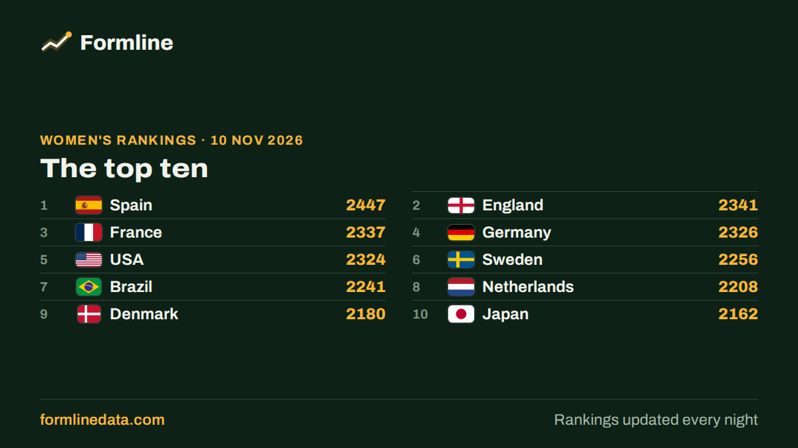

**This evening's post goes out on Bluesky and Instagram at about 6 pm Toronto time (7 pm in summer)** (on each one that's connected). To stop it, close this issue. To change it, ask Claude.

   

<sub>The last slide goes to Instagram only.</sub>

<details><summary>Alt text for each image (added automatically on Bluesky and Instagram)</summary>

1. Formline women's rankings, 10 Nov 2026, top ten with ratings: 1 Spain 2447, 2 England 2341, 3 France 2337, 4 Germany 2326, 5 USA 2324, 6 Sweden 2256, 7 Brazil 2241, 8 Netherlands 2208, 9 Denmark 2180, 10 Japan 2162.

2. Women's rankings, 10 Nov 2026, 11th to 20th: 11 Italy 2134, 12 Norway 2134, 13 Canada 2100, 14 Iceland 2041, 15 Australia 2031, 16 Colombia 2022, 17 Belgium 2020, 18 Portugal 2006, 19 Korea DPR 2006, 20 Republic of Ireland 2003.

3. Women's rankings, the last 30 days. Biggest risers in the top 60: Slovenia up 25, Finland up 22, Poland up 22. Biggest fallers: Canada down 24, Haiti down 23, El Salvador down 21.

4. Formline: every national team, rated every night. Follow @formline.data for match previews and rankings, and visit formlinedata.com.
</details>

**Instagram caption**
```text
Women's national football team rankings, 10 Nov 2026 📊

🥇 🇪🇸 Spain 2447
🥈 🏴󠁧󠁢󠁥󠁮󠁧󠁿 England 2341
🥉 🇫🇷 France 2337
4. 🇩🇪 Germany 2326
5. 🇺🇸 USA 2324
6. 🇸🇪 Sweden 2256
7. 🇧🇷 Brazil 2241
8. 🇳🇱 Netherlands 2208
9. 🇩🇰 Denmark 2180
10. 🇯🇵 Japan 2162

📈 Biggest riser this month: 🇸🇮 Slovenia (+25).
📉 Biggest faller: 🇨🇦 Canada (−24).

Where's your team? 👀 Swipe for 11th to 20th, or find every team on Formline (link in bio).

#LaRoja #Lionesses #France #WoSo #FootballRankings
```

---

**X version**, to post by hand: long-press the image to save it, then copy the text below.



```text
📊 Women's top 10, 10 Nov 2026

🥇 🇪🇸 Spain
🥈 🏴󠁧󠁢󠁥󠁮󠁧󠁿 England
🥉 🇫🇷 France
4. 🇩🇪 Germany
5. 🇺🇸 USA
6. 🇸🇪 Sweden
7. 🇧🇷 Brazil
8. 🇳🇱 Netherlands
9. 🇩🇰 Denmark
10. 🇯🇵 Japan

https://formlinedata.com/
```

<sub>rankings · rankings|women|2026-11-10 · @formlinedata</sub>
