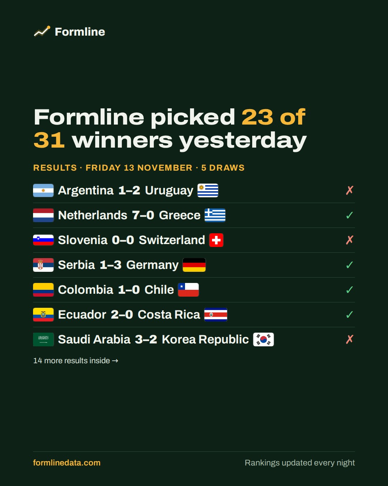
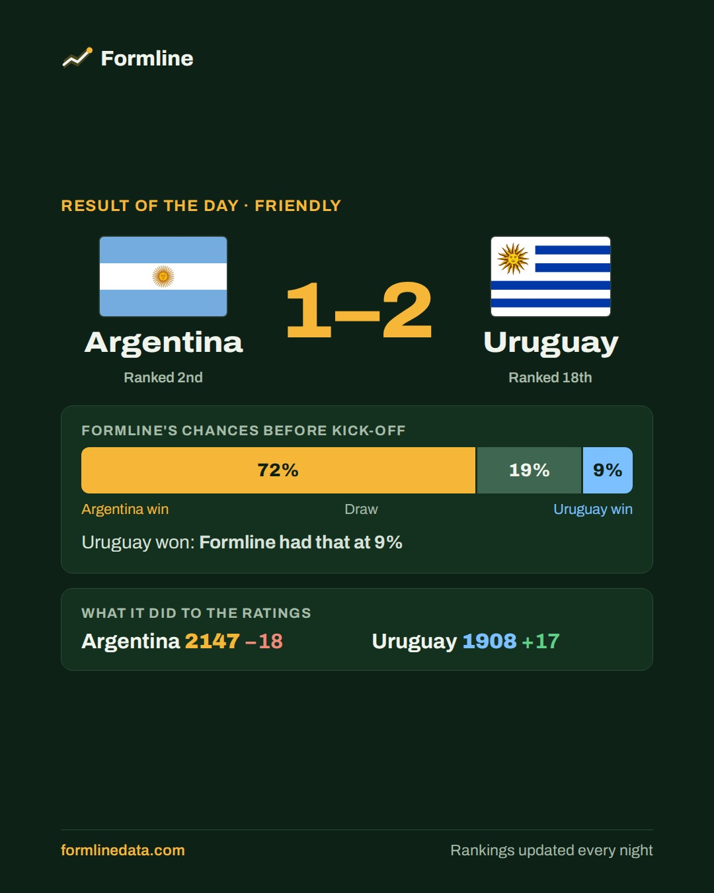
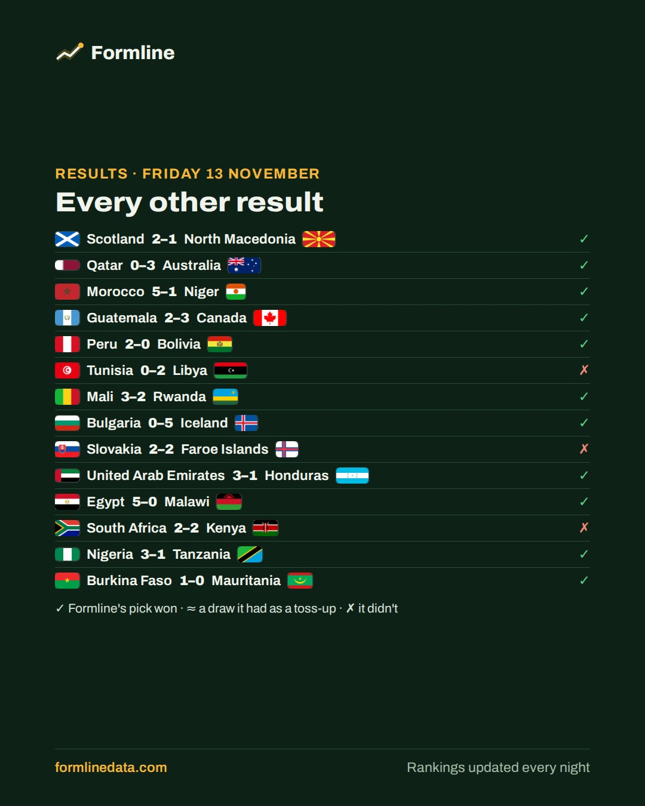
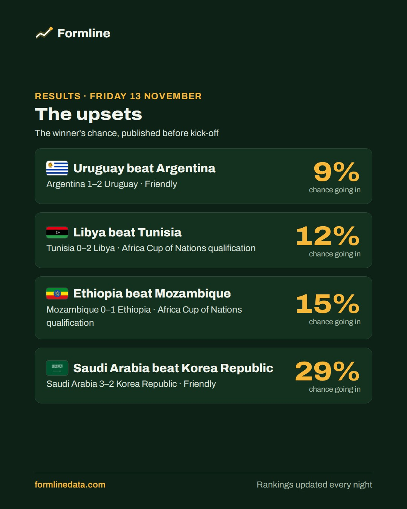
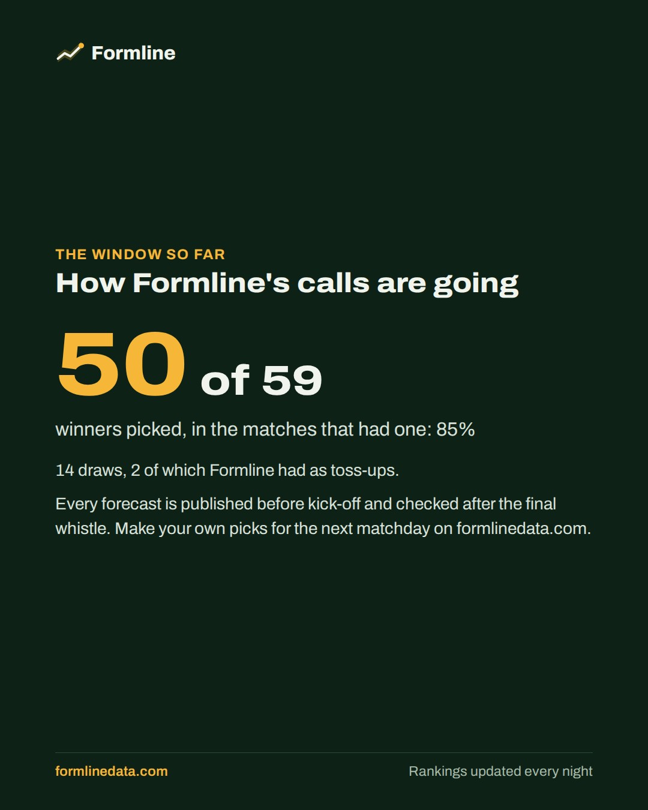
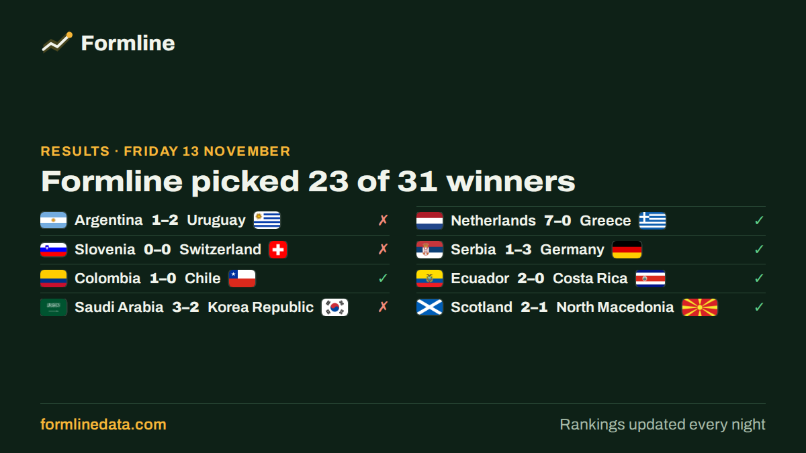

**This morning's results roundup goes out on Bluesky and Instagram at about 8 am Toronto time (9 am in summer)** (on each one that's connected). To stop it, close this issue. To change it, ask Claude.

     

<sub>The last slide goes to Instagram only.</sub>

<details><summary>Alt text for each image (added automatically on Bluesky and Instagram)</summary>

1. Results for Friday 13 November: Formline picked the winner in 23 of the 31 matches that had one; 5 draws. Argentina 1–2 Uruguay (wrong); Netherlands 7–0 Greece (right); Slovenia 0–0 Switzerland (wrong); Serbia 1–3 Germany (right); Colombia 1–0 Chile (right); Ecuador 2–0 Costa Rica (right); Saudi Arabia 3–2 Korea Republic (wrong).

2. Result of the day, Friendly: Argentina 1–2 Uruguay. Formline's chances before kick-off: Argentina 72%, draw 19%, Uruguay 9%. Ratings after it: Argentina 2147 (down 18), Uruguay 1908 (up 17).

3. More results for Friday 13 November: Scotland 2–1 North Macedonia (right); Qatar 0–3 Australia (right); Morocco 5–1 Niger (right); Guatemala 2–3 Canada (right); Peru 2–0 Bolivia (right); Tunisia 0–2 Libya (wrong); Mali 3–2 Rwanda (right); Bulgaria 0–5 Iceland (right); Slovakia 2–2 Faroe Islands (wrong); United Arab Emirates 3–1 Honduras (right); Egypt 5–0 Malawi (right); South Africa 2–2 Kenya (wrong); Nigeria 3–1 Tanzania (right); Burkina Faso 1–0 Mauritania (right).

4. The upsets of Friday 13 November, with the winner's chance before kick-off: Argentina 1–2 Uruguay, 9%; Tunisia 0–2 Libya, 12%; Mozambique 0–1 Ethiopia, 15%; Saudi Arabia 3–2 Korea Republic, 29%.

5. The window so far: Formline picked the winner in 50 of the 59 matches that had one; 14 draws, 2 of which it had as toss-ups.

6. Formline: every national team, rated every night. Follow @formline.data for match previews and rankings, and visit formlinedata.com.
</details>

**Instagram caption**
```text
International football results, Friday 13 November 📋

Formline picked the winner in 23 of the 31 matches that had one; 5 draws.

❌ 🇦🇷 Argentina 1–2 Uruguay 🇺🇾
✅ 🇳🇱 Netherlands 7–0 Greece 🇬🇷
❌ 🇸🇮 Slovenia 0–0 Switzerland 🇨🇭
✅ 🇷🇸 Serbia 1–3 Germany 🇩🇪
✅ 🇨🇴 Colombia 1–0 Chile 🇨🇱
✅ 🇪🇨 Ecuador 2–0 Costa Rica 🇨🇷
❌ 🇸🇦 Saudi Arabia 3–2 Korea Republic 🇰🇷
✅ 🏴󠁧󠁢󠁳󠁣󠁴󠁿 Scotland 2–1 North Macedonia 🇲🇰
✅ 🇶🇦 Qatar 0–3 Australia 🇦🇺
✅ 🇲🇦 Morocco 5–1 Niger 🇳🇪
…and 26 more in the slides

😱 Upset of the day: Uruguay won with a 9% chance.

📈 The window so far: 50 of 59 winners picked; 14 draws, 2 of which it had as toss-ups.

Which result surprised you most? 👇 Make your own picks for the next matchday at formlinedata.com (link in bio).

#Albiceleste #Oranje #FootballResults
```

---

**X version**, to post by hand: long-press the image to save it, then copy the text below.



```text
📋 Friday 13 November: Formline picked 23 of 31 winners (5 draws)

❌ 🇦🇷 Argentina 1–2 Uruguay 🇺🇾
✅ 🇳🇱 Netherlands 7–0 Greece 🇬🇷
❌ 🇸🇮 Slovenia 0–0 Switzerland 🇨🇭
✅ 🇷🇸 Serbia 1–3 Germany 🇩🇪

😱 Upset of the day: Uruguay won with a 9% chance.

https://formlinedata.com/#/matchday?ud=2026-11-13
```

<sub>roundup · roundup|2026-11-13 · @formlinedata</sub>
