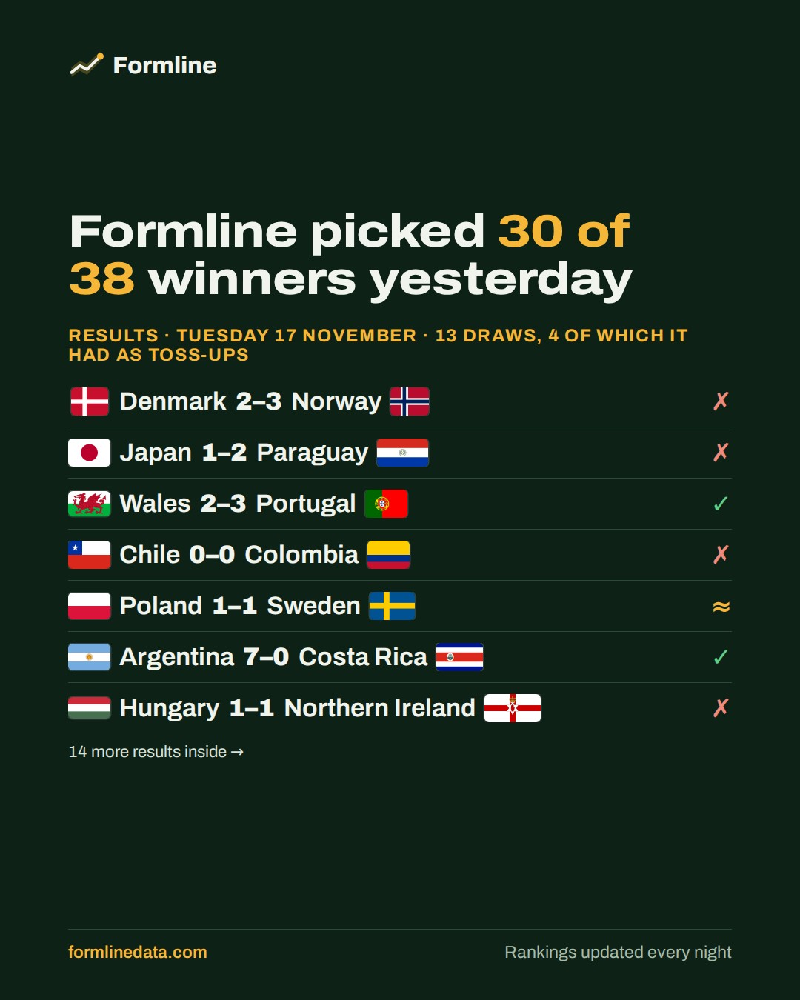
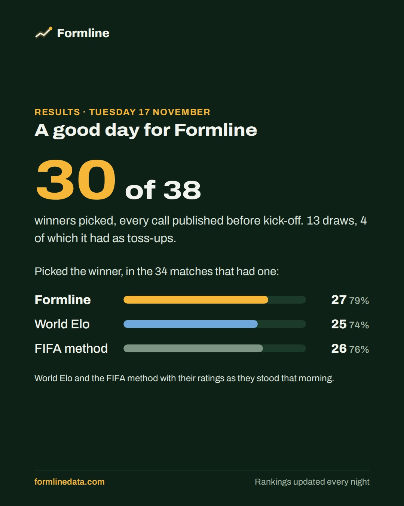
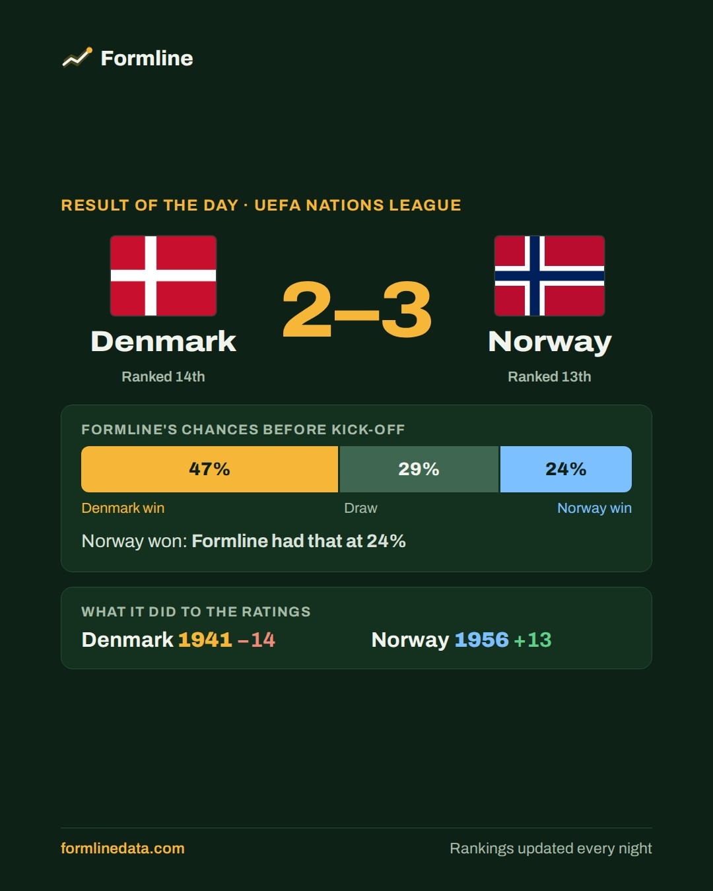
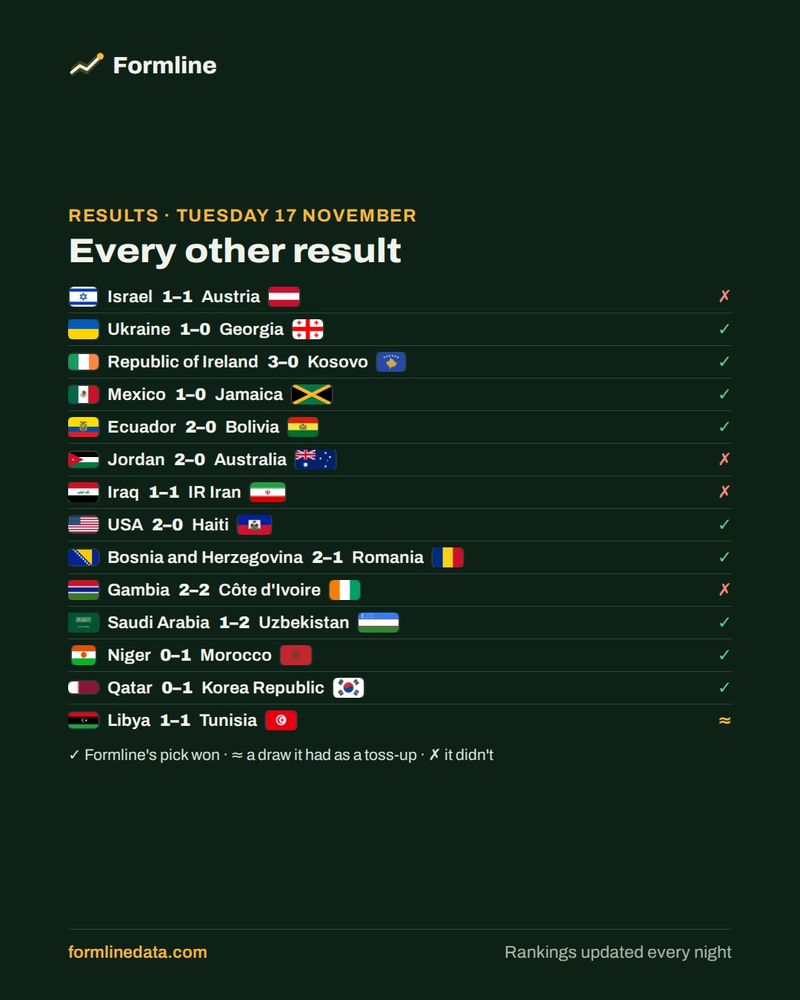
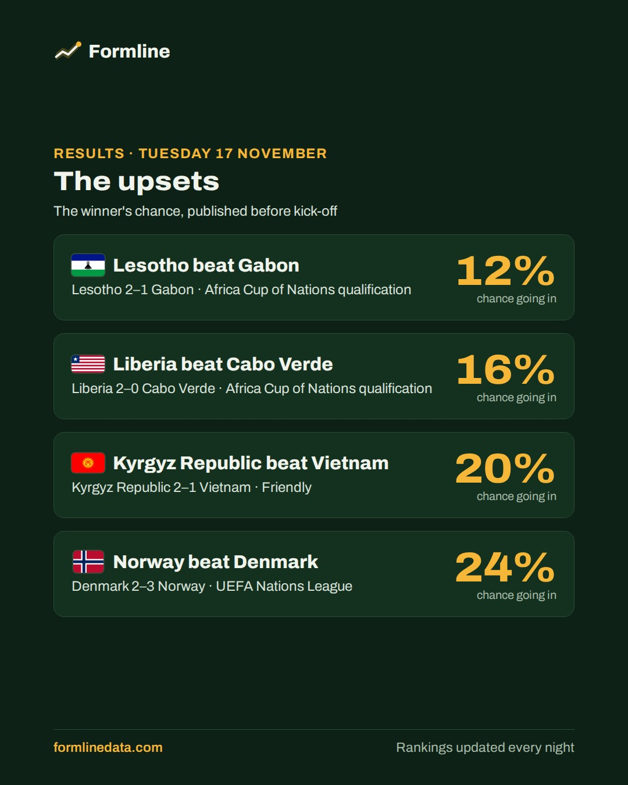
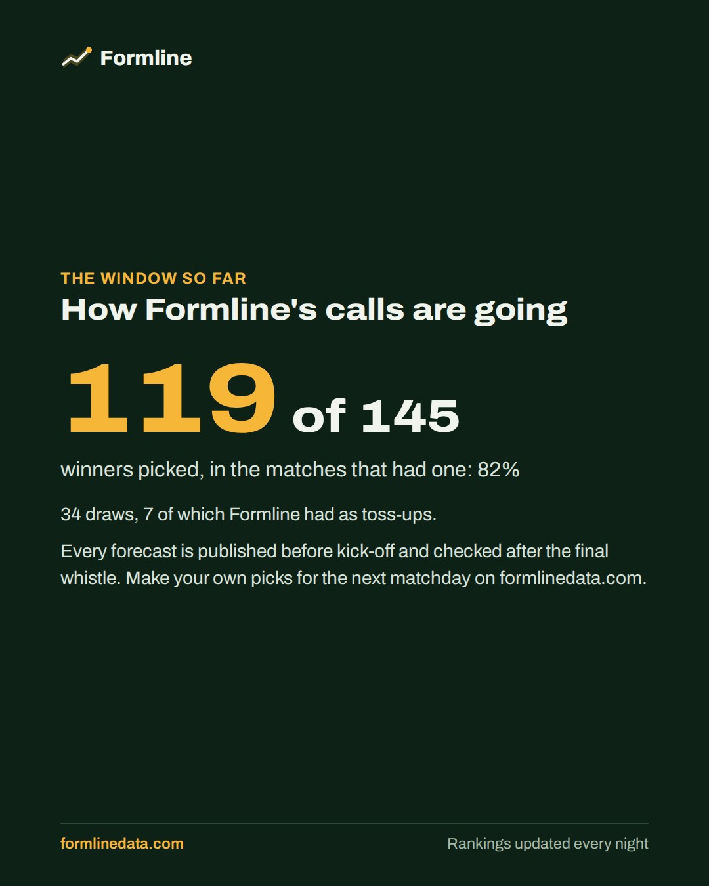
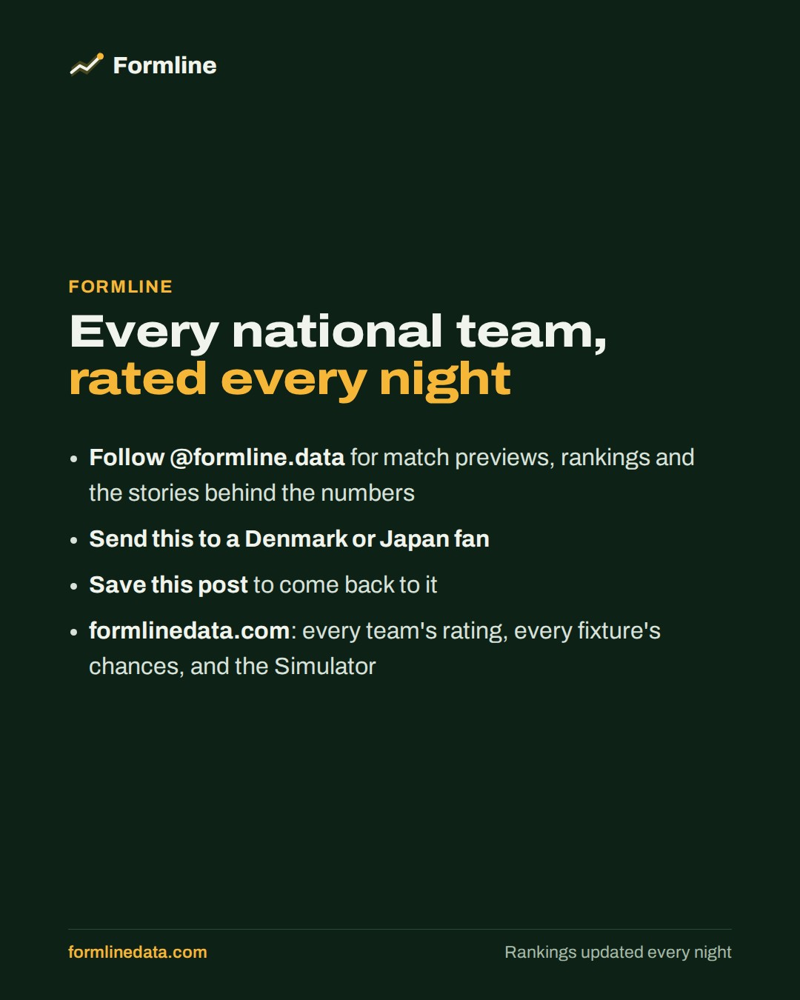
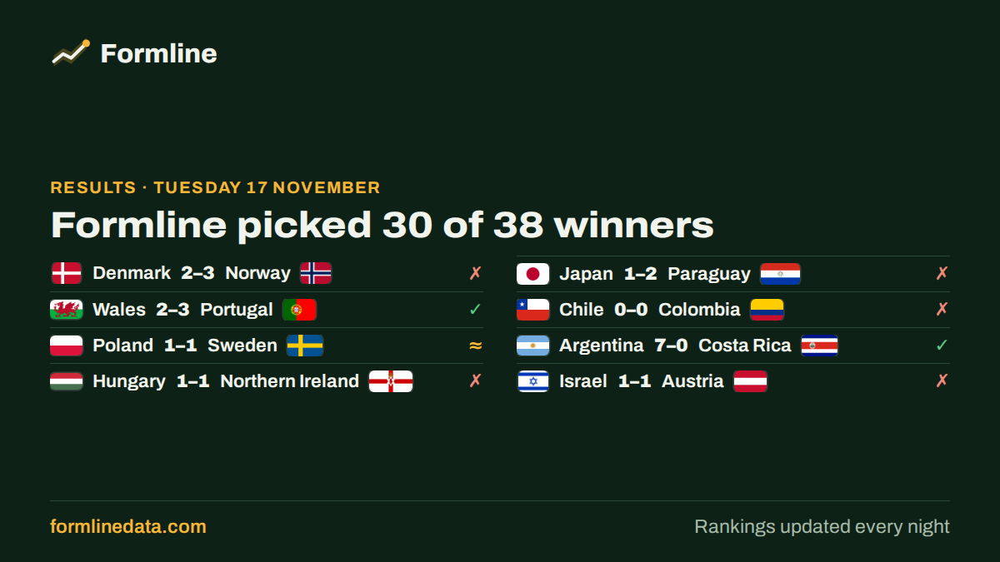

**This morning's results roundup goes out on Bluesky and Instagram at about 8 am Toronto time (9 am in summer)** (on each one that's connected). To stop it, close this issue. To change it, ask Claude.

      

<sub>The last slide goes to Instagram only.</sub>

<details><summary>Alt text for each image (added automatically on Bluesky and Instagram)</summary>

1. Results for Tuesday 17 November: Formline picked the winner in 30 of the 38 matches that had one; 13 draws, 4 of which it had as toss-ups. Denmark 2–3 Norway (wrong); Japan 1–2 Paraguay (wrong); Wales 2–3 Portugal (right); Chile 0–0 Colombia (wrong); Poland 1–1 Sweden (a draw it had as a toss-up); Argentina 7–0 Costa Rica (right); Hungary 1–1 Northern Ireland (wrong).

2. A good day for Formline: 30 of 38 winners picked; 13 draws, 4 of which it had as toss-ups. Picked the winner in the 34 matches that had one: Formline 27, World Elo 25, FIFA method 26. World Elo and the FIFA method with their ratings as they stood that morning.

3. Result of the day, UEFA Nations League: Denmark 2–3 Norway. Formline's chances before kick-off: Denmark 47%, draw 29%, Norway 24%. Ratings after it: Denmark 1941 (down 14), Norway 1956 (up 13).

4. More results for Tuesday 17 November: Israel 1–1 Austria (wrong); Ukraine 1–0 Georgia (right); Republic of Ireland 3–0 Kosovo (right); Mexico 1–0 Jamaica (right); Ecuador 2–0 Bolivia (right); Jordan 2–0 Australia (wrong); Iraq 1–1 IR Iran (wrong); USA 2–0 Haiti (right); Bosnia and Herzegovina 2–1 Romania (right); Gambia 2–2 Côte d'Ivoire (wrong); Saudi Arabia 1–2 Uzbekistan (right); Niger 0–1 Morocco (right); Qatar 0–1 Korea Republic (right); Libya 1–1 Tunisia (a draw it had as a toss-up).

5. The upsets of Tuesday 17 November, with the winner's chance before kick-off: Lesotho 2–1 Gabon, 12%; Liberia 2–0 Cabo Verde, 16%; Kyrgyz Republic 2–1 Vietnam, 20%; Denmark 2–3 Norway, 24%.

6. The window so far: Formline picked the winner in 119 of the 145 matches that had one; 34 draws, 7 of which it had as toss-ups.

7. Formline: every national team, rated every night. Follow @formline.data for match previews and rankings, and visit formlinedata.com.
</details>

**Instagram caption**
```text
International football results, Tuesday 17 November 📋

Formline picked the winner in 30 of the 38 matches that had one; 13 draws, 4 of which it had as toss-ups.

❌ 🇩🇰 Denmark 2–3 Norway 🇳🇴
❌ 🇯🇵 Japan 1–2 Paraguay 🇵🇾
✅ 🏴󠁧󠁢󠁷󠁬󠁳󠁿 Wales 2–3 Portugal 🇵🇹
❌ 🇨🇱 Chile 0–0 Colombia 🇨🇴
🟡 🇵🇱 Poland 1–1 Sweden 🇸🇪
✅ 🇦🇷 Argentina 7–0 Costa Rica 🇨🇷
❌ 🇭🇺 Hungary 1–1 Northern Ireland
❌ 🇮🇱 Israel 1–1 Austria 🇦🇹
✅ 🇺🇦 Ukraine 1–0 Georgia 🇬🇪
✅ 🇮🇪 Republic of Ireland 3–0 Kosovo
…and 41 more in the slides

😱 Upset of the day: Lesotho won with a 12% chance.

📊 Picked the winner in the 34 matches that had one: Formline 27, World Elo 25, FIFA method 26.

📈 The window so far: 119 of 145 winners picked; 34 draws, 7 of which it had as toss-ups.

Which result surprised you most? 👇 Make your own picks for the next matchday at formlinedata.com (link in bio).

#Denmark #SamuraiBlue #FootballResults
```

---

**X version**, to post by hand: long-press the image to save it, then copy the text below.



```text
📋 Tuesday 17 November: Formline picked 30 of 38 winners (13 draws, 4 of which it had as toss-ups)

❌ 🇩🇰 Denmark 2–3 Norway 🇳🇴
❌ 🇯🇵 Japan 1–2 Paraguay 🇵🇾
✅ 🏴󠁧󠁢󠁷󠁬󠁳󠁿 Wales 2–3 Portugal 🇵🇹
❌ 🇨🇱 Chile 0–0 Colombia 🇨🇴

😱 Upset of the day: Lesotho won with a 12% chance.

https://formlinedata.com/#/matchday?ud=2026-11-17
```

<sub>roundup · roundup|2026-11-17 · @formlinedata</sub>
