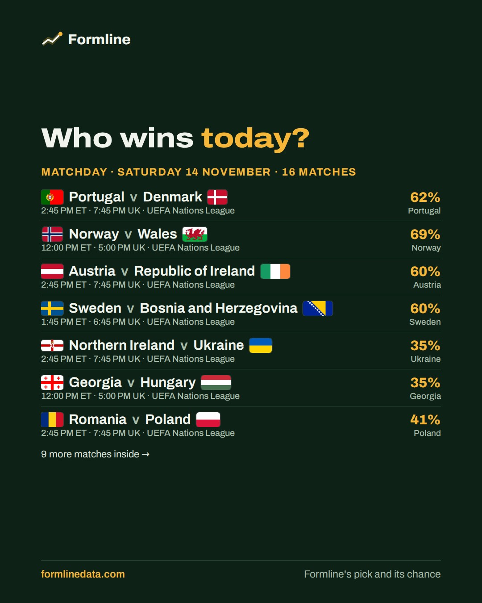
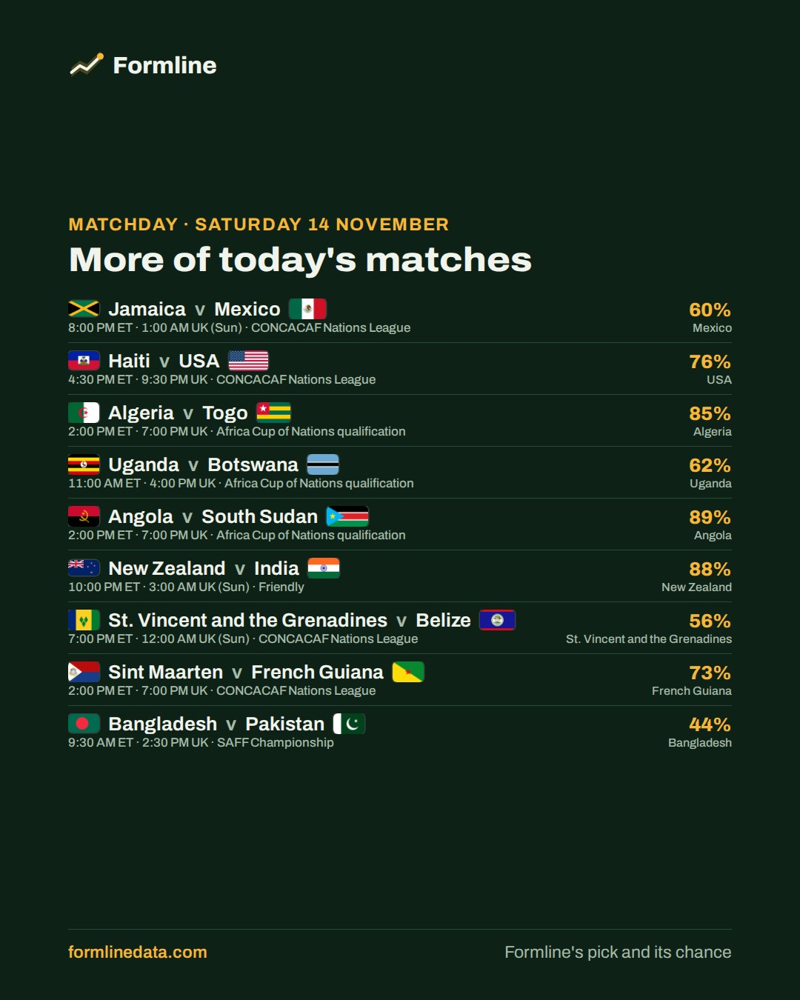
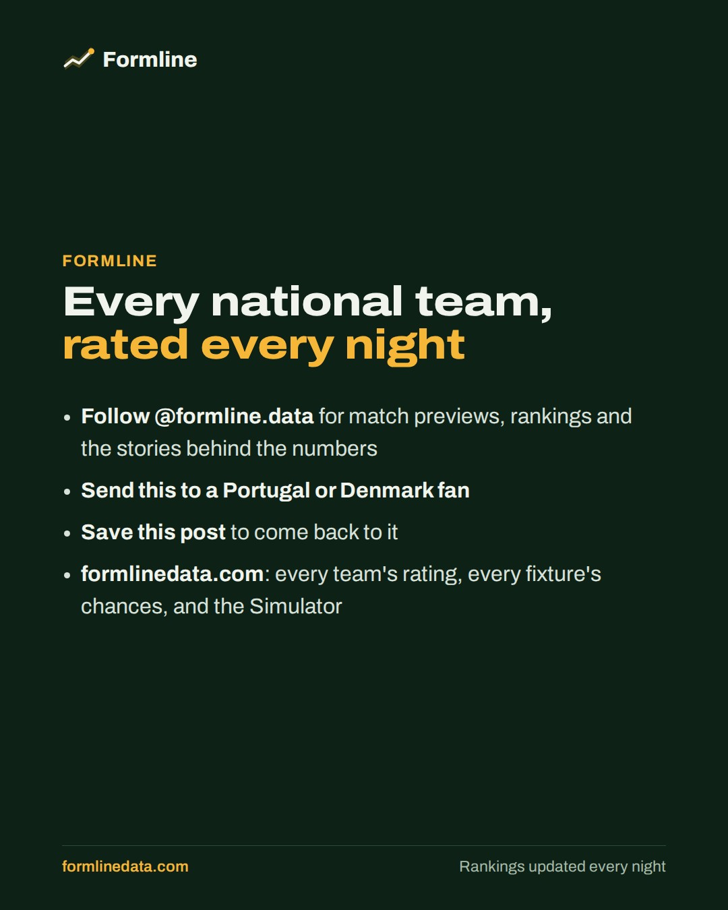
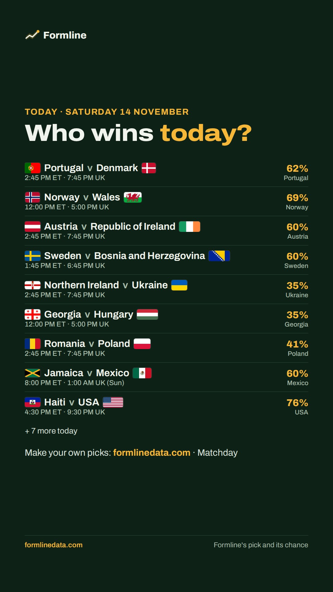
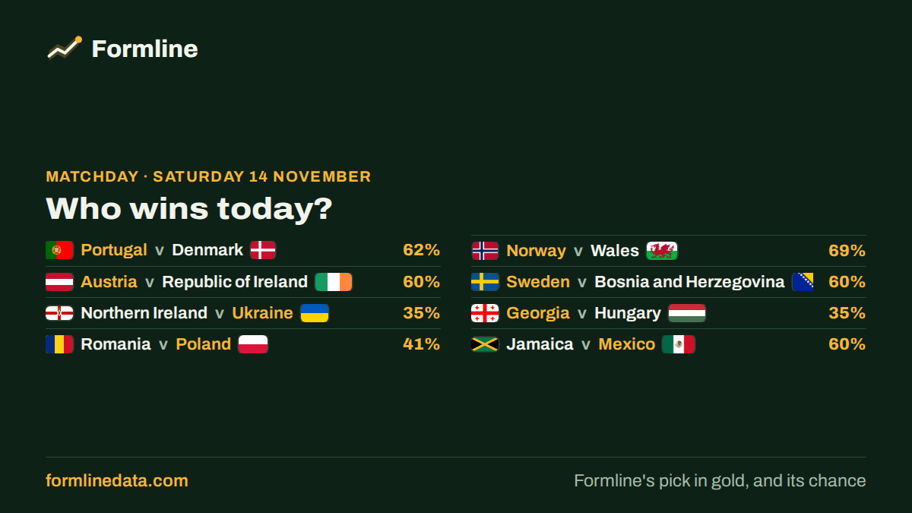

**Today's post goes out on Bluesky and Instagram at about 9 am Toronto time (10 am in summer)** (on each one that's connected). To stop it, close this issue. To change it, ask Claude.

  

<sub>The last slide goes to Instagram only.</sub>

**Instagram Story** (window days; goes out after the post):



<details><summary>Alt text for each image (added automatically on Bluesky and Instagram)</summary>

1. International matches today, Saturday 14 November, with Formline's pick and its chance: Portugal v Denmark, Portugal 62%, 2:45 PM ET, 7:45 PM UK; Norway v Wales, Norway 69%, 12:00 PM ET, 5:00 PM UK; Austria v Republic of Ireland, Austria 60%, 2:45 PM ET, 7:45 PM UK; Sweden v Bosnia and Herzegovina, Sweden 60%, 1:45 PM ET, 6:45 PM UK; Northern Ireland v Ukraine, Ukraine 35%, 2:45 PM ET, 7:45 PM UK; Georgia v Hungary, Georgia 35%, 12:00 PM ET, 5:00 PM UK; Romania v Poland, Poland 41%, 2:45 PM ET, 7:45 PM UK.

2. More of today's matches, Saturday 14 November: Jamaica v Mexico, Mexico 60%, 8:00 PM ET, 1:00 AM UK (Sun); Haiti v USA, USA 76%, 4:30 PM ET, 9:30 PM UK; Algeria v Togo, Algeria 85%, 2:00 PM ET, 7:00 PM UK; Uganda v Botswana, Uganda 62%, 11:00 AM ET, 4:00 PM UK; Angola v South Sudan, Angola 89%, 2:00 PM ET, 7:00 PM UK; New Zealand v India, New Zealand 88%, 10:00 PM ET, 3:00 AM UK (Sun); St. Vincent and the Grenadines v Belize, St. Vincent and the Grenadines 56%, 7:00 PM ET, 12:00 AM UK (Sun); Sint Maarten v French Guiana, French Guiana 73%, 2:00 PM ET, 7:00 PM UK; Bangladesh v Pakistan, Bangladesh 44%, 9:30 AM ET, 2:30 PM UK.

3. Formline: every national team, rated every night. Follow @formline.data for match previews and rankings, and visit formlinedata.com.
</details>

**Instagram caption**
```text
International football today, Saturday 14 November: Formline's predictions for 16 matches ⚽

🇵🇹 Portugal v Denmark 🇩🇰: Portugal 62% · 2:45 PM ET / 7:45 PM UK
🇳🇴 Norway v Wales 🏴󠁧󠁢󠁷󠁬󠁳󠁿: Norway 69% · 12:00 PM ET / 5:00 PM UK
🇦🇹 Austria v Republic of Ireland 🇮🇪: Austria 60% · 2:45 PM ET / 7:45 PM UK
🇸🇪 Sweden v Bosnia and Herzegovina 🇧🇦: Sweden 60% · 1:45 PM ET / 6:45 PM UK
Northern Ireland v Ukraine 🇺🇦: Ukraine 35% · 2:45 PM ET / 7:45 PM UK
🇬🇪 Georgia v Hungary 🇭🇺: Georgia 35% · 12:00 PM ET / 5:00 PM UK
…and 10 more in the slides

⏰ Kick-off times are Toronto (ET) and UK.

Which favourite slips up today? 👇 Make your own picks on Formline's Matchday (link in bio).

#Portugal #Denmark #NationsLeague #FootballPredictions
```

---

**X version**, to post by hand: long-press the image to save it, then copy the text below.



```text
⚽ Today's biggest matches, and who Formline picks:

🇵🇹 Portugal v Denmark 🇩🇰: Portugal 62%
🇳🇴 Norway v Wales 🏴󠁧󠁢󠁷󠁬󠁳󠁿: Norway 69%
🇦🇹 Austria v Republic of Ireland 🇮🇪: Austria 60%
🇸🇪 Sweden v Bosnia and Herzegovina 🇧🇦: Sweden 60%

https://formlinedata.com/#/matchday
```

<sub>today · today|2026-11-14 · @formlinedata</sub>
