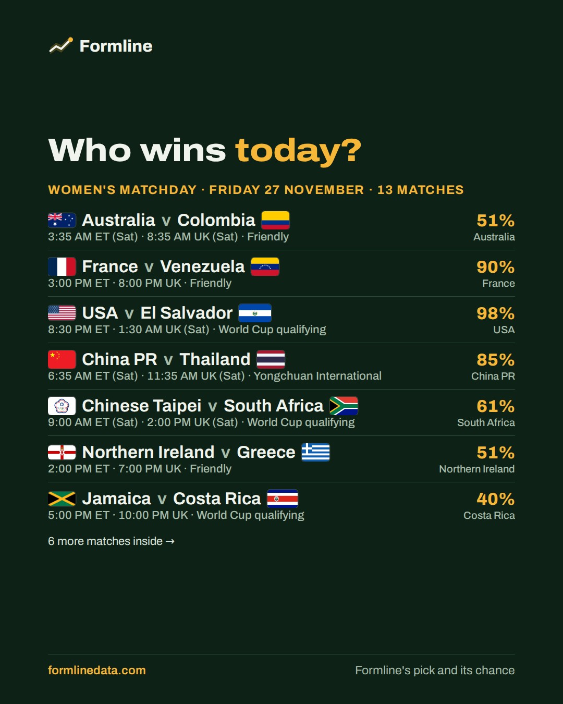
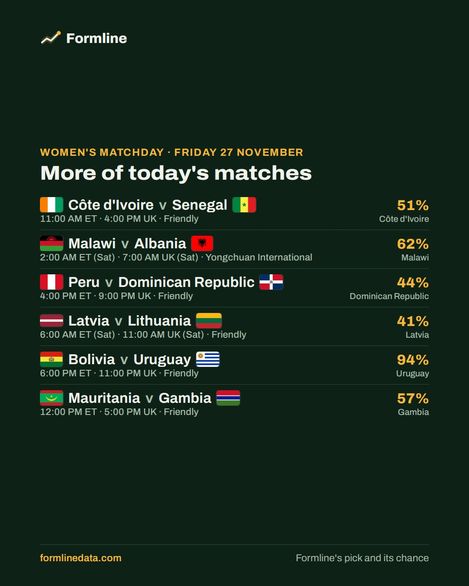
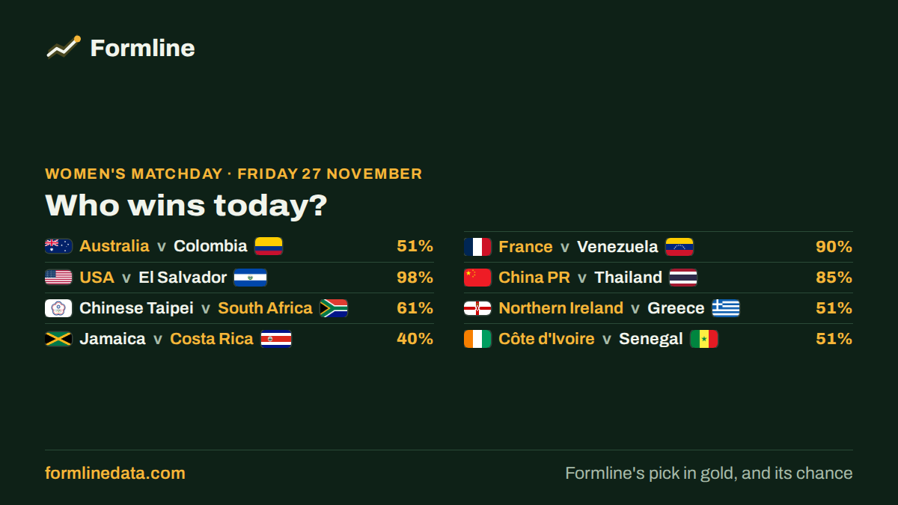

**Today's post goes out on Bluesky and Instagram at about 9 am Toronto time (10 am in summer)** (on each one that's connected). To stop it, close this issue. To change it, ask Claude.

  

<sub>The last slide goes to Instagram only.</sub>

<details><summary>Alt text for each image (added automatically on Bluesky and Instagram)</summary>

1. Women's international matches today, Friday 27 November, with Formline's pick and its chance: Australia v Colombia, Australia 51%, 3:35 AM ET (Sat), 8:35 AM UK (Sat); France v Venezuela, France 90%, 3:00 PM ET, 8:00 PM UK; USA v El Salvador, USA 98%, 8:30 PM ET, 1:30 AM UK (Sat); China PR v Thailand, China PR 85%, 6:35 AM ET (Sat), 11:35 AM UK (Sat); Chinese Taipei v South Africa, South Africa 61%, 9:00 AM ET (Sat), 2:00 PM UK (Sat); Northern Ireland v Greece, Northern Ireland 51%, 2:00 PM ET, 7:00 PM UK; Jamaica v Costa Rica, Costa Rica 40%, 5:00 PM ET, 10:00 PM UK.

2. More of today's matches, Friday 27 November: Côte d'Ivoire v Senegal, Côte d'Ivoire 51%, 11:00 AM ET, 4:00 PM UK; Malawi v Albania, Malawi 62%, 2:00 AM ET (Sat), 7:00 AM UK (Sat); Peru v Dominican Republic, Dominican Republic 44%, 4:00 PM ET, 9:00 PM UK; Latvia v Lithuania, Latvia 41%, 6:00 AM ET (Sat), 11:00 AM UK (Sat); Bolivia v Uruguay, Uruguay 94%, 6:00 PM ET, 11:00 PM UK; Mauritania v Gambia, Gambia 57%, 12:00 PM ET, 5:00 PM UK.

3. Formline: every national team, rated every night. Follow @formline.data for match previews and rankings, and visit formlinedata.com.
</details>

**Instagram caption**
```text
Women's international football today and overnight, Friday 27 November: Formline's predictions for 13 matches ⚽

🇦🇺 Australia v Colombia 🇨🇴: Australia 51% · 3:35 AM ET (Sat) / 8:35 AM UK (Sat)
🇫🇷 France v Venezuela 🇻🇪: France 90% · 3:00 PM ET / 8:00 PM UK
🇺🇸 USA v El Salvador 🇸🇻: USA 98% · 8:30 PM ET / 1:30 AM UK (Sat)
🇨🇳 China PR v Thailand 🇹🇭: China PR 85% · 6:35 AM ET (Sat) / 11:35 AM UK (Sat)
Chinese Taipei v South Africa 🇿🇦: South Africa 61% · 9:00 AM ET (Sat) / 2:00 PM UK (Sat)
Northern Ireland v Greece 🇬🇷: Northern Ireland 51% · 2:00 PM ET / 7:00 PM UK
…and 7 more in the slides

⏰ Kick-off times are Toronto (ET) and UK.

Which favourite slips up today? 👇 Make your own picks on Formline's Matchday (link in bio).

#Matildas #Colombia #InternationalFriendly #WoSo #FootballPredictions
```

---

**X version**, to post by hand: long-press the image to save it, then copy the text below.



```text
⚽ Today's biggest women's matches, and who Formline picks:

🇦🇺 Australia v Colombia 🇨🇴: Australia 51%
🇫🇷 France v Venezuela 🇻🇪: France 90%
🇺🇸 USA v El Salvador 🇸🇻: USA 98%
🇨🇳 China PR v Thailand 🇹🇭: China PR 85%

https://formlinedata.com/#/matchday
```

<sub>today · today|2026-11-27 · @formlinedata</sub>
