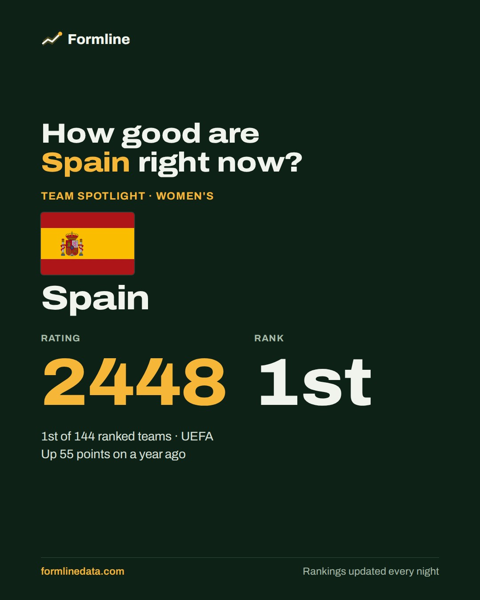
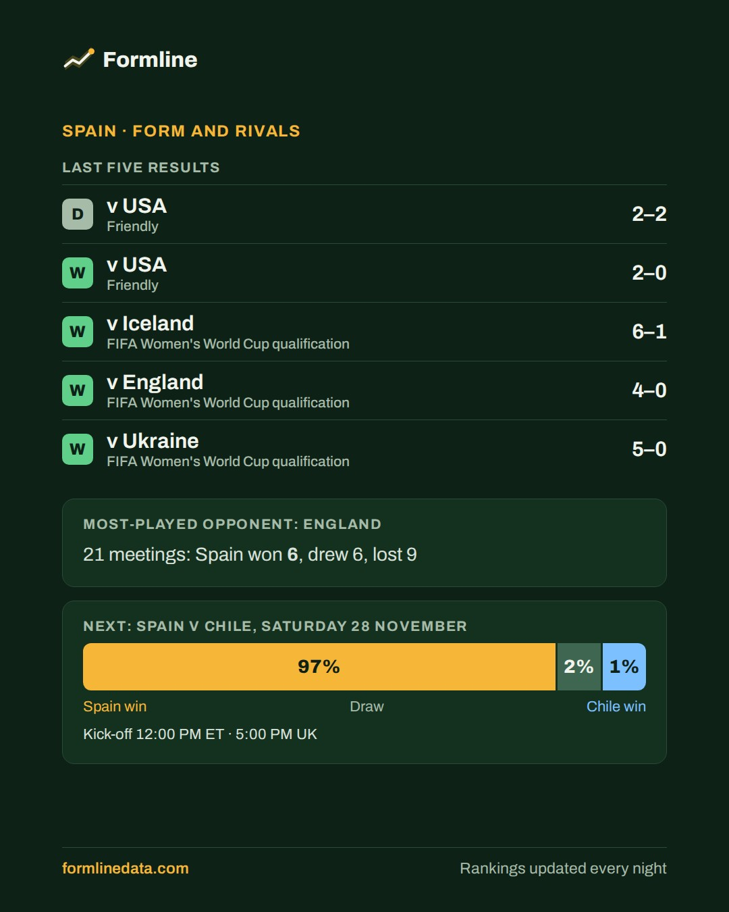
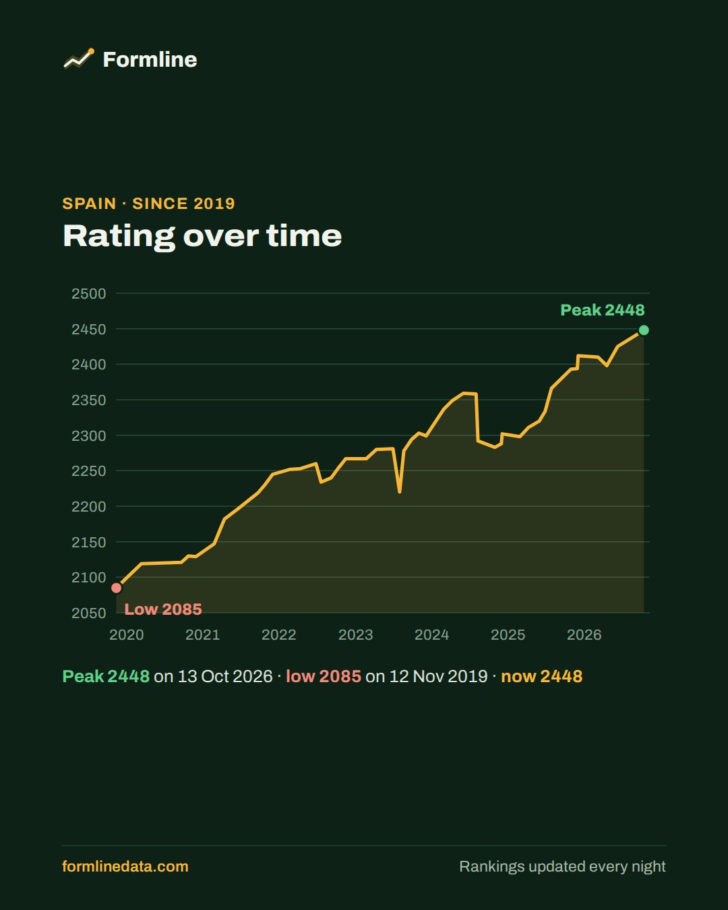
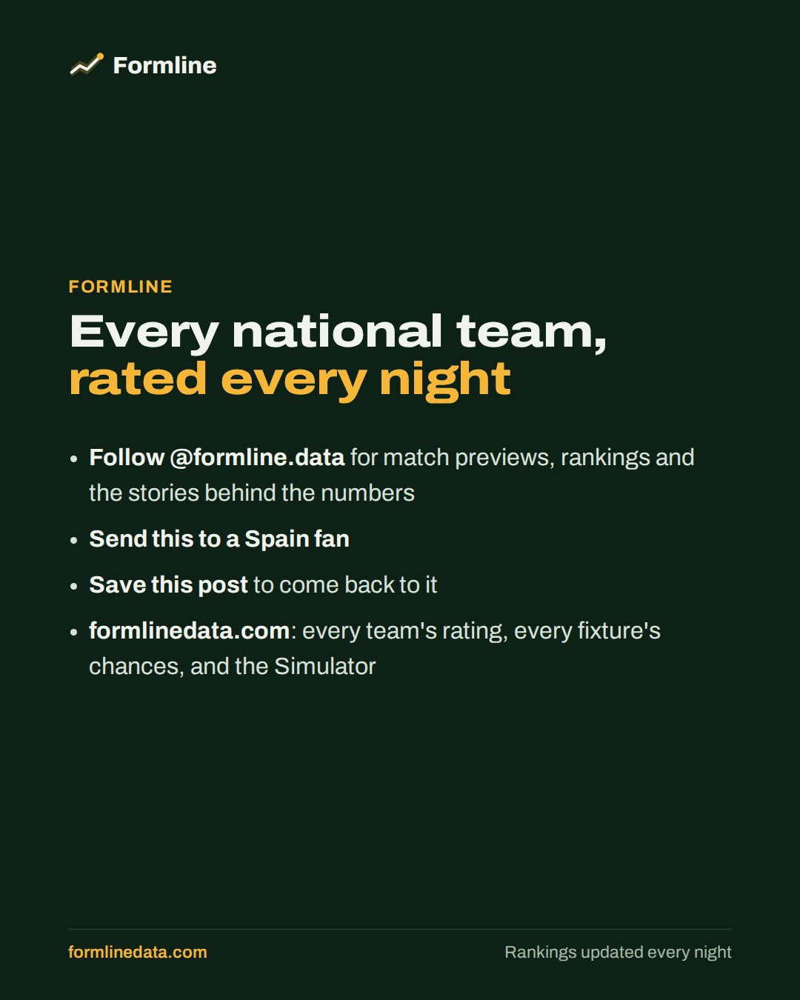
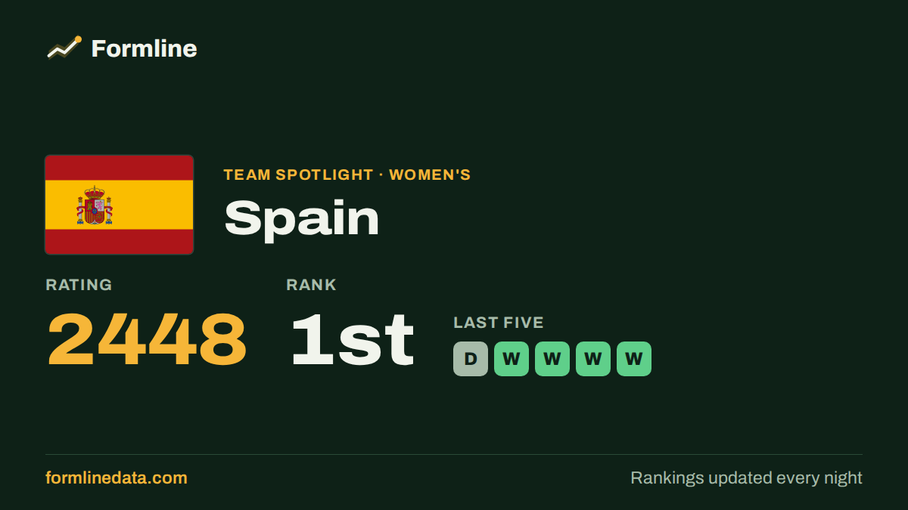

**Today's post goes out on Bluesky and Instagram at about 9 am Toronto time (10 am in summer)** (on each one that's connected). To stop it, close this issue. To change it, ask Claude.

   

<sub>The last slide goes to Instagram only.</sub>

<details><summary>Alt text for each image (added automatically on Bluesky and Instagram)</summary>

1. Team spotlight: Spain (women's). Rating 2448, ranked 1st of 144, UEFA. Up 55 points on a year ago.

2. Spain's last five results: drew 2–2 v USA (Friendly); won 2–0 v USA (Friendly); won 6–1 v Iceland (FIFA Women's World Cup qualification); won 4–0 v England (FIFA Women's World Cup qualification); won 5–0 v Ukraine (FIFA Women's World Cup qualification). Most-played opponent: England, 21 meetings, 6 wins, 6 draws, 9 defeats. Next: Spain v Chile, Saturday 28 November, 12:00 PM ET / 5:00 PM UK; chances Spain 97%, draw 2%, Chile 1%.

3. Line chart of Spain's Formline rating since 2019. Peak 2448 on 13 Oct 2026, low 2085 on 12 Nov 2019, now 2448.

4. Formline: every national team, rated every night. Follow @formline.data for match previews and rankings, and visit formlinedata.com.
</details>

**Instagram caption**
```text
Spain women's national team: rating, ranking and form 🇪🇸 🔦

📊 Rated 2448, 1st of 144. Up 55 points on a year ago 📈. Last five: DWWWW.

⛰️ Best since 2019: 2448 (2026). Lowest: 2085 (2019).

⚔️ Most-played opponent: 🏴󠁧󠁢󠁥󠁮󠁧󠁿 England, 21 meetings (6 wins, 6 draws, 9 defeats).

🗓️ Next up: Spain v Chile, Saturday 28 November, 12:00 PM ET / 5:00 PM UK.

Every team has its own page on Formline (link in bio) 👆

#LaRoja #InternationalFriendly #WoSo #FootballStats
```

---

**X version**, to post by hand: long-press the image to save it, then copy the text below.



```text
🔦 Team spotlight: 🇪🇸 Spain

📊 Rating 2448 · 1st of 144
🔥 Last five: DWWWW
⛰️ Peak since 2019: 2448 (2026)
⚔️ v England: 6–6–9 in 21

https://formlinedata.com/teams/women/spain.html
```

<sub>spotlight · spotlight|women|Spain · @formlinedata</sub>
